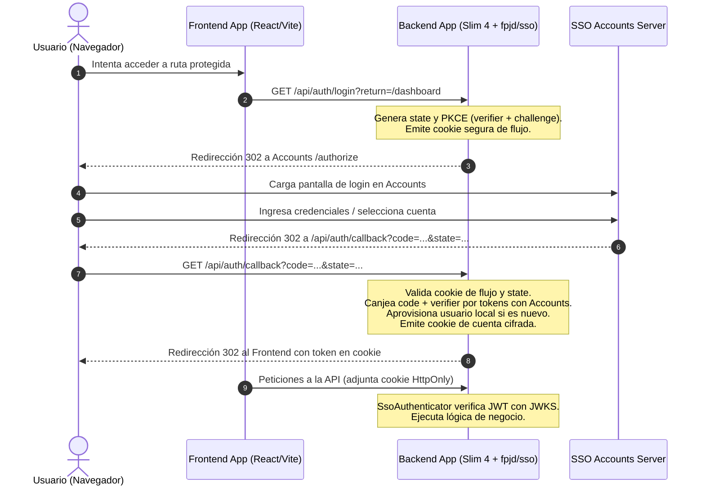

# Arquitectura Global del SSO FPJD

El sistema de Single Sign-On (SSO) de la **Fundación Parque Jaime Duque** permite centralizar las cuentas y credenciales de los colaboradores y operadores del parque, evitando la duplicación de usuarios, contraseñas y perfiles en cada sistema satélite (Cortesías, Almuerzos, Taquillas, etc.).

---

## 🏛️ Principios de Diseño

1. **Accounts es la Fuente Única de la Verdad para Identidad**:
   - Nombres, correos, documentos de identidad, estado activo/inactivo, empresas y gestiones residen y se administran exclusivamente en Accounts.
   - Las aplicaciones satélites no guardan contraseñas ni administran datos personales sensibles.
2. **Autorización y Perfiles Descentralizados**:
   - Cada aplicación decide qué roles, perfiles y permisos (`Permission`, `Profile`) tiene un usuario dentro de su propio dominio de negocio.
   - El enlace se realiza mediante el campo `user_auth_id` (UUID de Accounts) en la tabla `users` local.
3. **Seguridad y Criptografía Sin Estado (Stateless)**:
   - Acceso autenticado mediante JSON Web Tokens (**JWT**) firmados con algoritmo asimétrico **RS256** por Accounts.
   - Las claves públicas se publican en el endpoint estándar `/.well-known/jwks.json` y se validan en memoria/caché por los satélites.
   - Tokens de sesión y códigos de flujo protegidos con **AES-256-GCM** en cookies **HttpOnly**, **SameSite=Lax** y con prefijo `__Host-` en producción.
4. **Resiliencia y Modo Fail-Open**:
   - Si Accounts presenta una indisponibilidad temporal, la aplicación sigue aceptando tokens JWT válidos sin expulsar abruptamente a los usuarios.

---

## 🔄 Flujo de Autenticación (Authorization Code + PKCE)



---

## 🍪 Soporte Multi-cuenta en un Mismo Navegador

El paquete soporta de forma nativa que un operador o líder administrativo tenga **múltiples sesiones activas simultáneamente** en el mismo navegador:
- Cada cuenta se almacena en su propia cookie aislada: `<prefix>_a_<hash(user_id)>`.
- Existe una cookie de puntero `<prefix>_last` con la última cuenta utilizada.
- En pestañas independientes, el frontend puede enviar la cabecera HTTP:
  ```http
  X-Account: e4c9b362-9720-7f28-a28a-788bf30573be
  ```
  `SsoAuthenticator` prioriza la cuenta indicada en `X-Account`, permitiendo operar con diferentes cuentas en pestañas simultáneas sin colisiones.
